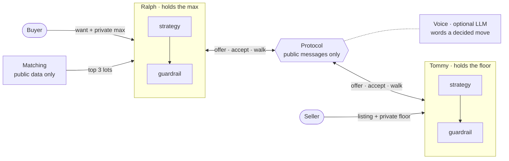

# Notes

How Ralph & Tommy is built, what it assumes, and where it goes next. Source numbers are in `src/fleek_market/core/config.py`.

1. [Assumptions](#assumptions)
2. [Design](#design)
3. [Evaluation](#evaluation): trade-offs, scale, rollout
4. [How it was built](#how-it-was-built)

---

## Assumptions

### The problem being solved

* Today a buyer messages ~5 suppliers, haggles in chat, and both sides drop off along the way. Fleek's matching can surface ~10 suppliers; the hard part is knowing which 3 are worth the prep work.
* Ralph & Tommy's job: buyer says what they want and the most they'll pay, and minutes later gets one of three answers:
  * Checkout: a deal inside both limits (lot, grade, quantity, price, supplier).
  * Near miss: the best price any seller offered, close to their max, flagged for an account-manager intro.
  * No fit: nothing came close.
* Neither side's private limit ever leaves its agent. That is the one rule everything else is built around.

### What a lot is

Simplified for modelling; real lots are more complex.

* A bale sold by piece count: 50, 100, 250 or 500 pieces, from one seller.
* One of six categories (tees, denim, jackets, knitwear, sportswear, dresses) and one grade:
  * A: near-new, premium brands. Typical list £9.00 per piece.
  * B: good condition, minor wear. Typical list £5.00.
  * C: visible wear, repair or upcycle stock. Typical list £2.50.
* Each seller's list price varies ±20% around that typical price.
* Grades are treated as trustworthy (in production, Fleek Sorts grading), so buyers can agree a price before seeing the bale.
* Piece count rather than kg, because buyers compare per-piece prices and bulk tiers are set by piece count.

### Buyers

* Two segments, using Fleek's spend bands. Learners (<£200/mo) are out of scope (post discussion w/ Freddy) as the business isn't prioritising them. Beyond spend-band all details are presumptions.

  | | Hobbyist | Pro |
  |---|---|---|
  | Spend | £200–2K a month, side hustle | £2K+ a month, full time; physical shops are almost always pros |
  | Share of buyers | 70% | 30% |
  | Pieces wanted | 50–100 | 250–500 |
  | Private max | 70–95% of typical list | 72–92% of typical list |
  | Ralph opens | 15% below sticker | 25% below sticker |
  | Patience | 4 rounds | 6 rounds |
  | Concession | gives ground early | holds firm, caves late |

* Each buyer wants one category, a best acceptable grade, and sometimes the grade below it.
* The max is set against the typical price of the best grade they'd take, and only Ralph ever holds it.

### Sellers

* Publish a list price per piece and three bulk tiers that anyone can see: 5% off at 100 pieces, 10% at 250, 15% at 500. List price after the tier discount is the sticker price.
* Hold a private floor at 75–85% of list, capped at the deepest-tier price (a seller won't advertise a discount they'd refuse).
* Tommy opens at the sticker price, gives 6 rounds and holds firm until late.

### The negotiation

* Alternating offers on price per piece, buyer first, at most 6 rounds. Quantity is fixed at what Ralph asks for (the want, or what's left of the lot).
* Each move is an offer, an accept of the offer on the table, or a walk-away.
* Each buyer works down its top 3 sellers until one deal closes. Buyers go in turn and stock is shared, so an early buyer can take pieces a later one wanted.

### Marketplace

* Fleek takes 15% commission on GMV (agreed price × quantity).
* Shipping, duties and credit terms are out of scope for this build (credit terms: see [Scale](#scale)).

### Scale of the simulation

* 20 sellers with 3–8 lots each (110 lots) and 100 buyers, scaled down from ~1,000 sellers and ~50,000 buyers. The design doesn't change at full size; [Scale](#scale) covers what does.
* Everything is seeded, so the same seed always gives the same market and the same outcomes.

### What is a guess

* Every price, range, patience and curve above is a reasoned guess, not Fleek data. That's why they all live in one config file: when a real number arrives, change it and rerun.

### Changes to these assumptions

10 Nov 12:05 - Pro max range is 72–92% of typical list:

* An earlier tightening (to 62–85%, to bring dealable pairs into a 60–75% band) hit pros hardest: 32% couldn't reach any shortlisted seller's floor, and pros closed 35% vs hobbyists' 50%.
* Pros are Fleek's priority segment, so pricing a third of them out of every lot by assumption is hard to defend. Restored to the original range; nothing else retuned.
* Now, over 20 seeds: 17% of pros have no reachable floor, pros close 47% and hobbyists 49%, and 80% of shortlisted pairs are dealable.

10 Nov 12:30 - Hobbyists walk after 4 rounds, Tommy concedes late:

* Hobbyist patience is 4 rounds. Tommy concedes on a 1.5 curve over 6, so at round 4 he's still well above his target. That's why about half of possible deals don't close (53% of buyers with a dealable seller close).
* Every hobbyist miss is the hobbyist walking. Pros wait the full 6 rounds; all their misses are timeouts.
* `seller_concession_curve` is the lever: at 1.0, hobbyists with a dealable seller close 57% instead of 52%, for about 1 point off the average price.
* Deals average ~93% of list, but list is the single-piece price. Bulk tiers (5–15% off at 100/250/500 pieces) account for ~3.5 points of that gap and haggling the other ~3.5. 86% of hobbyist deals are under 100 pieces, so get no tier.

---

## Design

### How information flows

### Who knows what

| | Buyer | Ralph | Matching | Protocol | Voice | Tommy | Seller |
|---|:-:|:-:|:-:|:-:|:-:|:-:|:-:|
| Buyer's max | ✓ | ✓ | | | | | |
| Seller's floor | | | | | | ✓ | ✓ |
| An agent's margin and price path | | own | | | | own | |
| Listing: grade, pieces, list price, tiers | ✓ | ✓ | ✓ | | ✓ | ✓ | ✓ |
| Want: category, grades, quantity | ✓ | ✓ | ✓ | | | quantity | |
| Offers, accepts, walks | best counter | ✓ | | ✓ | the one it words | ✓ | the deal |
| Near miss or no fit | ✓ | ✓ | | | | | |

* The only thing that crosses between Ralph and Tommy is a public `Message`: round, sender, kind, offer, text.
* Only the simulator (`cli.run_market`) holds every secret, because it plays both principals. In production that role doesn't exist: each agent loads only its own limit.

### The moving parts

* Matching (`matching/match.py`):
  * Filter: lots are indexed by (category, grade), so a buyer only sees lots in its category, at a grade it accepts, with enough pieces to be worth it.
  * Rank: 0.5 × price (sticker vs the grade's typical price, rescaled across candidates) + 0.3 × grade fit (1 for the best grade, 0.5 for the one below) + 0.2 × quantity fit.
  * Shortlist: best lot per seller, then the top 3 sellers. On the demo market, 283 of 11,000 possible pairs (2.6%) get negotiated.
* Strategy (`negotiation/strategy.py`): each agent makes a private plan once, from the public listing and its own limit, then every move is a lookup. Accept if their offer is at least as good as my next counter; walk once past my own deadline.
* Guardrails (`negotiation/guardrails.py`): the last thing every outgoing message passes, inside the agent that owns the limit.
* Protocol (`negotiation/protocol.py`): the referee. Runs turns, enforces public rules, ends in a deal, walk-away or timeout.
* Ralph and Tommy (`agents/`): about 15 lines each. Hold the secret, ask the plan for a move, run it through the guardrail, send it. Ralph also writes the report back to his buyer.
* Voice (`agents/voice.py`): optional. Rewords a decided move; can't change it.

### Design notes

9 Nov 01:55 - Three walls around the private numbers:

* Types: a buyer's max and a seller's floor live in `core/private.py`, whose repr hides the value. Printing or logging an agent can't leak it.
* Imports: protocol, matching and voice never import `private.py` (tests check protocol and voice). Code that never holds a limit can't leak one.
* Data: matching ranks on public data only (wants, lots, sticker prices), so nobody can game the ranking with a limit either.

9 Nov 18:10 - The guardrail fails closed:

* Every outgoing message passes `guardrails.enforce` inside the agent that owns the limit. Anything that would cross the limit becomes a bare walk-away.
* The walk carries no reason, because "that's above my max" is itself a hint at the max.
* A bug can lose a deal but can't break a limit. The property tests run many random markets and check no deal ever closes outside either limit.

9 Nov 18:20 - Strategy concedes over time and stops short:

* Price moves from the opening towards a private target as `opening + (target - opening) * progress**curve`. Hobbyists concede early, pros hold firm then cave late, sellers have their own curve; all in config.
* Target = limit minus (buyer) or plus (seller) a margin drawn per agent, so the other side never sees the real limit, even at the final offer.
* Buyers round down and sellers round up to the price tick, so rounding can never push an offer past the target.
* Each agent privately picks the round it reaches its target by and nudges each step (see Trade-offs, 10 Nov 12:20). Still one-way, still on the target by the deadline.

9 Nov 21:50 - The protocol is a referee, not a player:

* It knows whose turn it is, what's on the table and when time runs out. It checks only public rules (right sender, right round, accept only what's on the table).
* Whether a price is acceptable is each agent's own business. A malformed move counts as a walk.

10 Nov 00:15 - The LLM words a move, it never makes one:

* Voice runs after the guardrail on a decided move and can only fill `Message.text`. Its prompt holds the public message and lot, nothing else.
* Every number in its reply must be public for that move, or the template is used. A wrong price or an invented "13% off" both fall back.
* Off by default. Any failure (no key, timeout, auth) prints one line and the demo carries on with plain wording.

---

## Evaluation

### How it performs

| | Demo market (seed 7) | 20 seeds |
|---|---|---|
| Buyers who close | 53 / 100 | 47% pros, 49% hobbyists |
| Shortlisted pairs where a deal is possible | 82% | 80% |
| Average price vs list | 92% | ~93% |
| Near misses flagged for an AM | 16 | |
| GMV / Fleek's 15% take | £30,816 / £4,622 | |
| Deals outside either limit | 0 | 0 |

* 73 tests run in a few seconds, including 500+ closed deals checked against both limits, a privacy sweep over 20,000+ messages, and an attack on Ralph's offers.

### Trade-offs

9 Nov 01:58 - Shortlist instead of negotiating with everyone:

* Lots are indexed by (category, grade), so a buyer only scores lots it could accept rather than the full buyers × lots cross product.
* `shortlist_k = 3` keeps the run fast and each buyer's options readable. A buyer whose top 3 all fail doesn't try another, even if it might have worked.

9 Nov 19:12 - Fixing one leak created another:

* Seller floors were drawn at 75–90% of list, so some sat above the 15%-off bulk price: a seller advertising a discount they'd refuse.
* Capping floors at the deepest-tier price fixed that, but the cap bound on 35% of lots, which put a third of sellers' private floors exactly on a public price.
* Narrowing the range to 75–85% cut that to ~1.4% (rounding only) while keeping 80% of shortlisted pairs dealable, so the demo still shows both outcomes. The cap thus stays as a safety net.
* TLDR: anything that clamps a private value to a public one turns the clamp into a disclosure, so measure how often it binds, not just that it holds.

9 Nov 19:20 - Private margins cost some deals:

* A fixed public margin would let anyone back out the limit from a final offer, so each agent draws its own (2–6%).
* The price: two agents who could deal can both stop short and time out at 6 rounds. That's the right way round, since a lost deal is recoverable and a leaked floor isn't.

9 Nov 23:50 - Privacy tests trade precision for no false alarms:

* Substring matching flagged "1.9" inside "£1.93" and the "6" in seller S06. Text is now matched on whole numbers outside IDs, and reports only on £ amounts.
* A limit spelled out in words ("four pounds") would get past the check. Text is either a template or number-checked LLM output, so nothing writes numbers that way today.

10 Nov 00:12 - Buyers go in turn, first come first served:

* Keeps runs deterministic and the demo reproducible, but early buyers get first pick of shared stock.
* Voice calls run concurrently instead (about 26s down to 3s), since each message is worded independently and order is restored afterwards.

10 Nov 12:20 - Privacy tests checked what was sent, not what could be inferred:

* No agent ever sends its limit, but the price path was a smooth formula. We attacked our own agent: a Tommy who has read `strategy.py`, holds firm and sees Ralph's first three offers estimated Ralph's max to a median error of 1.02% (p90 1.92%), over 20 seeds. Only the private margin stood in the way.
* Randomising each agent's opening discount and curve didn't help (1.07%, p90 2.08%). The opening is visible, and three offers solve the formula for curve and target.
* Two private draws do help: each step is nudged up to ±30%, and each agent reaches its target up to a round early. Together they raise the error to 1.79% (p90 9.20%), against 1.61% (p90 6.50%) for the nudge alone.
* Neither costs deals. The nudge alone leaves closes flat (654 vs 647 hobbyists, 286 vs 285 pros). The horizon closes 31 more hobbyist deals and lifts GMV 2.0%: concessions come sooner, so more land before a hobbyist walks. Surplus split unchanged (buyers 68%, sellers 32%).
* The real privacy budget is the margin between where an agent stops and its limit, and widening it costs deals:

  | Margin | Median error | p90 error | Hobbyists closed | Pros closed |
  |---|---|---|---|---|
  | 2–6%, no noise | 1.02% | 1.92% | 46% | 47% |
  | 2–10%, no noise | 2.09% | 3.83% | 41% | 42% |
  | 2–15%, no noise | 3.48% | 6.36% | 37% | 37% |
  | 2–6% with nudge and horizon (current) | 1.79% | 9.20% | 49% | 47% |

* Some leakage can't be avoided: any accepted price reveals max >= price. So the goal is noisy inference, not zero. `tests/test_inference.py` runs the attack and fails if the error drops back towards the no-noise level.

### Expansion

#### Scale

What changes at ~50,000 buyers and ~1,000 sellers:

* Matching stays cheap. Indexing by (category, grade) means each buyer scores only the lots it could accept, never the 50M buyer-seller pairs, and each buyer still negotiates with just 3 sellers.
* Negotiation is plain arithmetic. 50,000 buyers × 3 sellers × at most 12 messages is under 2M small messages per full cycle, with no LLM in the loop.
* Niche requests ("Levi's mixed, with holes, delivered within a week") are facts only the seller knows. At scale Ralph asks Tommy before negotiating: matching narrows the field, and the question confirms what's actually in stock.
* Credit terms are the next thing to negotiate after price and volume: another public offer field, with Fleek's credit limit for that buyer as a private bound inside the guardrail.
* Grades and list prices come from Fleek Sorts and seller history rather than a generator.

9 Nov 02:00 - Matching moves to the database: wants and lots indexed by category and grade, shortlists recomputed when a listing or want changes, not per run.

9 Nov 22:48 - Margins in production come from a secure random source (e.g. `secrets`), not a seed built from IDs. The demo seeds each agent's RNG from the config seed plus buyer/lot IDs so runs are reproducible, but anyone who knows that scheme can rebuild the margin and back out the limit from a final offer.

9 Nov 23:55 - Negotiations run concurrently, so stock needs reserving: hold the pieces when a negotiation starts (with an expiry), or re-check and decrement atomically on accept and walk if it's gone.

10 Nov 00:20 - Limits and LLM at scale:

* Limits sit in their own store, and each agent process loads only the one limit it owns. Reads are audited.
* Guardrail replacements get counted. A walk the strategy didn't intend means a bug, so the rate should sit at zero.
* LLM wording only for messages a person reads, with the number check kept. Cost and latency stay bounded and a provider outage changes wording, not outcomes.
* Near misses go to a queue for account managers rather than a printed list.
* The same seeded-RNG caveat applies to the strategy's noise: in production it comes from `secrets` too.

#### Rollout

Start with small proof, then scale:

1. Pilot: 50 online hobbyists. Every deal Ralph proposes needs the buyer's approval (propose, I approve). Compare against the same buyers buying by hand.
2. Expand: more sellers and categories. Deals under a set value close without a click once the override rate is low.
3. Launch: all hobbyists and pros. For pros, the agent preps and the account manager closes, with near misses as their queue. Ralph becomes a hook in acquisition outreach.

Before the pilot:

* Real inputs: Sorts grades, seller list prices and history, buyer briefs.
* The production pieces from [Scale](#scale): limits store, secure randomness, stock reservation.

What to measure:

* North star: deals closed per week by agents, against the same buyers buying by hand.
* Time to deal: from buyer brief to agreed terms (target: minutes, not days).
* Price outcome: agreed price against similar manual deals.
* Repeat rate: buyers who brief Ralph again within 30 days.
* Override rate: how often buyers reject a proposed deal. The trust signal: when it falls, raise the auto-close threshold.

---

## How it was built

### Matching: my design

* From my experience with recommender systems, I scoped matching as two-stage retrieval: cheap candidate generation, then scoring only what survives.
  * Stage 1, blocking on hard constraints: lots are indexed by (category, grade), so a buyer only ever touches lots it could accept. A minimum-quantity filter drops lots too small to be worth the shipping. This is what turns 50M buyer-seller pairs into a few hundred candidates per buyer.
  * Stage 2, a linear scoring model over public features: price vs market (sticker relative to the grade's typical price, min-max rescaled across a buyer's candidates), grade fit and quantity fit, weighted 0.5 / 0.3 / 0.2.
  * Diversity constraint: best lot per seller, then top-k sellers, so negotiations spread across sellers rather than piling into one seller's lots.
* Private limits are excluded from the feature set by design. Matching can't leak a limit, and nobody can game their ranking by misreporting one.
* `test_matching.py` checks the index against a brute-force scan on generated markets, so the speed-up never changes who gets matched.

### Three agents

| Agent | Role | Context it worked from |
|---|---|---|
| Design | Turned my design decisions and brief into step-by-step build specs; checked each step against Fleek's context before the next | Brief, Fleek call notes (e.g. conversation with Freddy), the live repo |
| Build | Built one step per commit, co-designing with me; ran `make test` and `make demo` after every step; measured before changing any number | The repo and the current spec |
| Review | Audited the repo cold, with no build history, as a sceptical reviewer would | The repo only |

* The loop: design specifies → build implements and measures → design checks against the brief → review attacks the result → design specifies the fix.
* No agent marks its own work. The builder doesn't approve its own changes, and the review agent never sees how a decision was reached, only what it produced.
* Every claim tied to a measure. Close rates, leak rates and attacker error come from scripted runs over 20 seeds, not from reading code.

### Where the loop changed the build

* Stakeholder context into config (`c1a8b88`): the commercial call redefined the segments (learners out, Fleek's spend bands in). The design agent turned that into a spec; the build agent changed the enum and config in one commit.
* A fix measured into a better fix (`bc03c5c`): capping floors at the bulk price closed one leak, but the build agent's measurement showed the cap binding on 35% of lots, putting private floors on a public price. The range was narrowed so the cap only catches rounding.
* A leak found by reasoning (`5337b6d`): the design agent spotted that a fixed public margin lets anyone compute the limit as final offer ÷ 0.97. Margins became private draws.
* Builder pushback, accepted (`26cfa94`): the spec asked privacy tests to check offers never equal an agent's target. The build agent measured 4,252 of 26,344 offers landing on target by design and proposed the right property instead (essentially never concede past it).
* A leak found by attack (`a11a19a`, `99e5db3`): the review agent solved Ralph's price formula from three offers and recovered his max to ~1%. The first specified fix (randomising opening and curve) was measured, shown not to work, and dropped. Per-round noise plus a hidden horizon raised attacker error with no cost to deals. The attack is now a permanent test.
* A tuning side-effect caught (`6106f26`): the review agent flagged that an earlier viability tweak had priced a third of pros out of every lot. The pro range was restored.

### AI inside the product

* The same rule applies to the LLM in the product as to the agents that built it: it proposes wording, code decides deterministically. Voice only fills `Message.text` after the guardrail has approved the move, and any number it writes is checked against the public offer before it's used.
